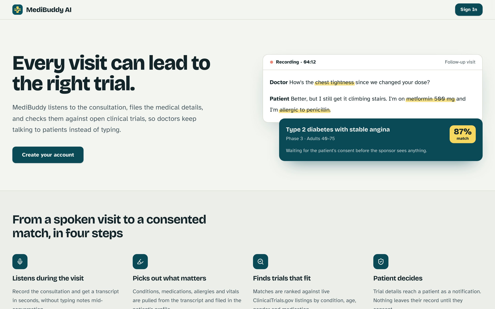
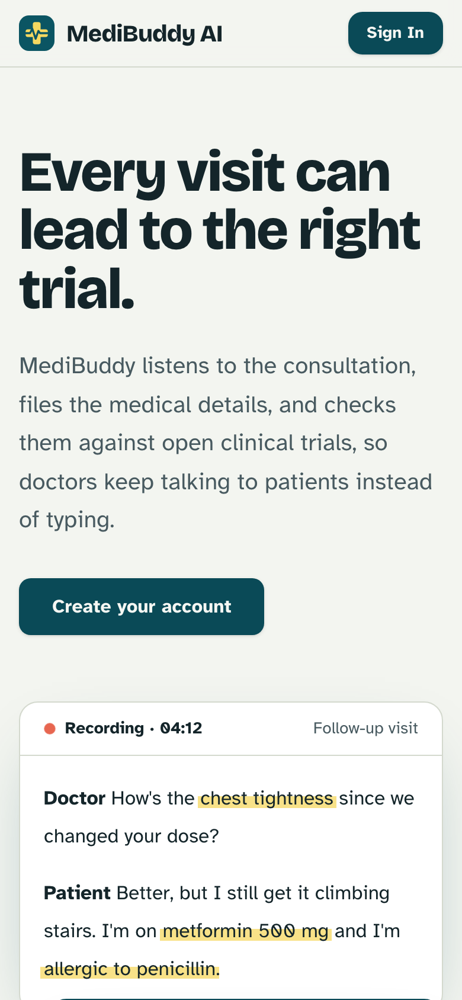

# MediBuddy AI

MediBuddy listens to a doctor-patient consultation, turns it into a transcript, a structured medical record and a report, and checks the patient against open clinical trials, so doctors keep talking to patients instead of typing. Patients stay in control: nothing is shared with a trial sponsor without their consent.

<p align="center">
  
</p>

<p align="center">
  
</p>

> **Status: prototype.** The app has not had a privacy or security review and is not approved for real patient data. All demo data is fictional.

## What it does

**For doctors**
- Record a consultation and get a transcript in seconds (speech-to-text).
- Medical entities (conditions, medications, allergies, vitals) are extracted and filed automatically.
- A SOAP-format medical report is generated and can be shared with the patient.
- Patients are matched against clinical trials by condition, age, gender, medications, comorbidities and allergies. Review the matches and send them on.
- Schedule appointments, and reopen any past visit to replay the recording and read the transcript and report.

**For patients**
- A dashboard with upcoming appointments, a medical profile and shared reports.
- Replay a visit's recording once the doctor has shared it.
- Trial notifications with an explicit approve or decline, and a consent history.

**Matching**
- A trial must match at least one of the patient's conditions (abbreviations like COPD, CKD and RA are understood), then is scored on age, gender, medications, comorbidities and allergies.
- Live listings come from the [ClinicalTrials.gov API](https://clinicaltrials.gov/data-api/api); [Fetch.ai ASI-1](https://innovationlab.fetch.ai/) adds an analysis of each match.

## Tech stack

| Area | Technology |
|---|---|
| Frontend | React 18, TypeScript, Vite, Tailwind CSS, shadcn/ui (Radix) |
| Backend and database | [Convex](https://convex.dev) (functions, real-time database, file storage) |
| Authentication | [Clerk](https://clerk.com) |
| Speech-to-text | Groq Whisper (`whisper-large-v3-turbo`) |
| Language model | Any OpenAI-compatible chat API, such as OpenAI or Gemini (see [configuration](#configuration)) |
| Trial data | ClinicalTrials.gov API v2, Fetch.ai ASI-1 |
| Tests | Vitest and `convex-test` |

## How it works

```
 record visit ──▶ Convex storage ──▶ speech-to-text ──▶ transcript
                                                          │
                              ┌───────────────────────────┤
                              ▼                           ▼
                     entity extraction (LLM)        medical report (LLM)
                              │
                              ▼
          trial matching (local trials + ClinicalTrials.gov + ASI-1)
                              │
                              ▼
        doctor reviews ──▶ patient notified ──▶ patient consents or declines
```

Recording, transcription, extraction and matching run automatically as background jobs after a recording is saved.

## Getting started

### Prerequisites
- Node.js 18 or newer
- A free [Convex](https://convex.dev) account and a [Clerk](https://clerk.com) application
- A [Groq](https://groq.com) API key (speech-to-text) and an API key for a language model provider (OpenAI, Gemini or similar)

### 1. Install
```bash
git clone <repository-url>
cd MediBuddy
npm install
```

### 2. Start the backend
```bash
npx convex dev
```
The first run asks you to log in and create a project. It writes `CONVEX_DEPLOYMENT` and `VITE_CONVEX_URL` to `.env.local`. Leave it running: it deploys your `convex/` code whenever it changes.

### 3. Set up Clerk
1. Create a Clerk application and copy the **Publishable key** into `.env.local`:
   ```
   VITE_CLERK_PUBLISHABLE_KEY=pk_test_...
   ```
2. In Clerk, go to **Configure → Sessions → JWT templates** and create a template named exactly **`convex`** (choose the Convex preset if offered).
3. Copy your **Frontend API URL** (for example `https://your-name-12.clerk.accounts.dev`) from **Configure → Developers → API keys**. You'll set it in the next step.

### 4. Configure the backend
Convex does not read `.env` files. Set each server-side value on your deployment:

```bash
npx convex env set CLERK_SIGNING_KEY https://your-name-12.clerk.accounts.dev
npx convex env set GROQ_API_KEY <your Groq key>
npx convex env set LLM_API_KEY <your provider key>
npx convex env set LLM_MODEL <model name>
npx convex env set ASI1_API_KEY <your ASI-1 key>
```

See [`.env.example`](.env.example) for every variable.

### 5. Run the app
```bash
npm run dev
```
Open http://localhost:5173, sign up, and choose a role. New accounts start as patients; go to `/role-selection` to become a doctor.

## Configuration

| Variable | Where | Purpose |
|---|---|---|
| `VITE_CONVEX_URL` | `.env.local` | Your Convex deployment URL (written by `npx convex dev`) |
| `VITE_CLERK_PUBLISHABLE_KEY` | `.env.local` | Clerk publishable key |
| `CLERK_SIGNING_KEY` | Convex | Your Clerk Frontend API URL (the token issuer) |
| `GROQ_API_KEY` | Convex | Speech-to-text |
| `LLM_API_KEY` | Convex | API key for the language model provider |
| `LLM_MODEL` | Convex | Model name |
| `LLM_BASE_URL` | Convex | Optional. Defaults to OpenAI (`https://api.openai.com/v1`) |
| `ASI1_API_KEY`, `ASI1_BASE_URL`, `ASI1_MODEL` | Convex | Clinical trial analysis |

### Choosing a language model provider

Entity extraction and report generation go through one OpenAI-compatible client in [`convex/llm.ts`](convex/llm.ts), so switching provider or model is a configuration change, not a code change:

```bash
# OpenAI
npx convex env set LLM_API_KEY <key>
npx convex env set LLM_MODEL gpt-4

# Gemini (OpenAI-compatible endpoint)
npx convex env set LLM_API_KEY <key>
npx convex env set LLM_BASE_URL https://generativelanguage.googleapis.com/v1beta/openai
npx convex env set LLM_MODEL gemini-flash-latest
```

Providers differ on a few request options. If one rejects `max_tokens`, `temperature` or JSON mode, the client adjusts the request and retries automatically.

## Demo data

To see the app populated, seed it. You need a signed-in **doctor** account first (and optionally a patient account):

```bash
npx convex run seed:seedDemoData      # 10 patients, 11 trials, consultations, appointments, matches
python3 scripts/seed_audio.py         # adds a spoken recording to every seeded consultation
```

The audio script generates speech with the macOS `say` command, using one voice for the doctor and another for each patient, so it needs macOS. The seed itself works anywhere.

```bash
npx convex run seed:resetDemoData     # remove everything the seed created, including audio
```

All names, trials and clinical content are fictional.

## Testing

```bash
npm test
```

67 tests run against your real Convex functions in memory, with fake logins and a faked language model, so they need no network, no API keys and no deployment. They cover:

- **Access control:** anonymous callers get nothing; patients see only their own records; doctors see all patients; who may create, share and play recordings.
- **Workflows:** appointments, sharing a report, trial consent and its history.
- **Trial matching:** the condition requirement, abbreviations and synonyms.
- **AI features:** entity extraction, report generation, and the language model client's handling of provider differences.
- **Demo data:** seeding, resetting, and the transcript format the audio script depends on.

Other checks: `npx tsc --noEmit` (types), `npm run lint`, `npm run build`.

## Project structure

```
convex/            backend
  schema.ts          database tables
  authz.ts           access-control rules used by every public function
  llm.ts             the language model client
  consultations.ts, meetings.ts, audio.ts, notifications.ts, ...
  trialMatching.ts, conditionMatching.ts, clinicalTrials.ts, asi1.ts
  medicalEntityExtraction.ts, medicalReports.ts
  seed.ts            demo data
src/
  pages/             doctor/ and patient/ screens
  components/        UI, audio recorder and player, medical views
  agents/            client-side agent messaging (ASI-1)
tests/             Vitest suites
scripts/           seed_audio.py
docs/screenshots/  images used in this README
```

## Access control

Every public backend function checks who is calling. Doctors can access all patients' records; patients can access only their own, and can hear a visit's recording only after the doctor shares it. Background jobs run with no user, so they call internal versions of the functions that skip the check. When adding a function, add its check; the tests in `tests/access.test.ts` show the pattern.

## Deployment

The frontend is a static Vite build; `vercel.json` is included for [Vercel](https://vercel.com). Create a separate Convex **production** deployment, set the same environment variables on it, use Clerk's production keys, and set `VITE_CONVEX_URL` and `VITE_CLERK_PUBLISHABLE_KEY` in your hosting environment. A production deployment starts with an empty database.

## Roadmap

- Custom matching logic for more nuanced eligibility (stage-specific trials, comorbidities).
- Doctor-to-patient assignment, so doctors see only their own patients.
- Biometric consent (voice or face verification).
- A doctor-side analytics dashboard for trial recommendations.
- Optional encrypted backup of summaries and transcripts.

## Why we built it

Every year, thousands of clinical trials go under-enrolled, not because patients are unwilling, but because they don't know a trial exists. Doctors rarely have time to search eligibility criteria during a short appointment, on top of taking notes. We asked: what if trial matching could happen automatically in the background of a normal visit, with the patient in full control of what is shared? MediBuddy is our answer.
